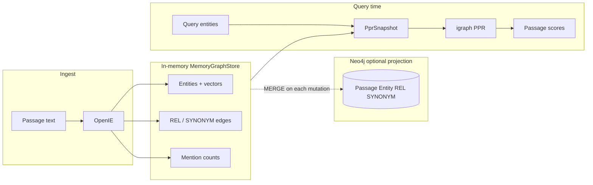

# HippoRAG: memory graph construction, updates, Neo4j, and PPR

This document describes **how qlab’s HippoRAG experiment builds and updates the hippocampal index**, how that index relates to **Neo4j**, and **how Personalized PageRank (PPR) is executed**. It is written for operators and for a future refactor toward **Neo4j as the primary graph store** (GDS PageRank, single source of truth).

**Code map**

| Concern | Module |
|--------|--------|
| In-memory graph (authoritative for retrieval) | `hipporag_core/memory_graph_store.py` |
| Neo4j dual-write | `hipporag_core/neo4j_graph_store.py` |
| Backend selection | `hipporag_core/graph_store.py` |
| Indexing (OpenIE → graph) | `hipporag_core/indexer.py` |
| PPR snapshot export | `memory_graph_store.export_ppr_snapshot()` → `ppr_snapshot.py` |
| PPR execution | `hipporag_core/ppr.py` (igraph) |
| Query → seeds → passages | `hipporag_core/linking.py`, `retriever.py`, `passage_scoring.py` |
| HTTP lifecycle | `server/routes/corpus.py`, `index.py`, `retrieve.py` |
| Runtime wiring | `hipporag_core/runtime.py`, `main.py` |

Paper: [HippoRAG (NeurIPS 2024)](https://arxiv.org/abs/2405.14831). Official reference implementation uses igraph PPR; qlab matches that path in Python.

---

## 1. Conceptual model

HippoRAG’s “memory graph” is an **entity–passage index**:

- **Passages** are text chunks (staged first, indexed second).
- **Entities** are normalized phrases (OpenIE NER + triple endpoints).
- **Edges** connect entities (OpenIE relations + optional **synonymy**).
- **Mentions** link entities to passages (counts), not as graph edges in PPR—mentions feed **passage scoring** after PPR on the entity graph.

Retrieval **never reads Neo4j today**. Every `POST /retrieve` exports an in-memory **`PprSnapshot`**, runs **igraph** PPR on entity nodes, then aggregates node mass onto passages via the mention matrix.



---

## 2. In-memory data structures

`MemoryGraphStore` holds:

| Field | Type | Role |
|-------|------|------|
| `_passages` | `dict[id → _StagedPassage]` | Passage body + content hash + last indexed hash |
| `_entities` | `dict[eid → canonical text]` | Entity nodes |
| `_entity_vectors` | `dict[eid → np.ndarray]` | Embeddings for linking + synonymy |
| `_triples` | `list[Triple]` | Stored triples (audit / counts; not direct PPR edges) |
| `_rel_edges` | `set[(eid_a, eid_b)]` | Undirected relational edges (sorted pair keys) |
| `_synonym_edges` | `set[(eid_a, eid_b)]` | Undirected synonymy edges |
| `_mentions` | `dict[eid → dict[passage_id → count]]` | Entity→passage mention weights |

**Entity ids** are stable hashes of normalized phrase text (`entity_ids.entity_id` + `normalize_phrase`).

**Staging vs indexing**

1. `stage_passage(Passage)` — stores text and `content_hash`; does **not** add entities or edges.
2. `pending_passage_ids()` — passages where `indexed_hash != content_hash`.
3. After OpenIE indexing, `mark_passage_indexed(passage_id)` sets `indexed_hash = content_hash` (idempotent re-index skip until text changes).

This split is what `POST /corpus/passages` vs `POST /index` express at the API.

---

## 3. Graph construction (indexing pipeline)

Entry points:

- `POST /index` — OpenIE for all pending passages, then synonymy pass.
- `POST /corpus/bootstrap-toy` / startup `HIPPORAG_BOOTSTRAP_TOY=1` — fixture OpenIE from `eval/toy_multihop/openie.json`.

### 3.1 Per-passage OpenIE → graph (`Indexer._index_one`)

For each `OpenIEExtraction`:

1. **Entities list** — for each phrase: `merge_entity(phrase, encoder)` → `eid`; `add_mention(eid, passage_id, 1)`.
2. **Triples** — for each triple:
   - `merge_entity(subject)`, `merge_entity(object)`.
   - `add_mention` for subject and object on this passage.
   - `add_rel(sub_eid, obj_eid)` — one undirected REL edge (deduped set).
   - `add_triple(triple)` — append to triple list.

`merge_entity` encodes the phrase once and caches the vector in `_entity_vectors`.

### 3.2 Corpus-wide synonymy (`Indexer.add_synonymy_edges`)

After entity nodes exist:

1. `export_ppr_snapshot()` → all entity vectors.
2. `pairs_above_threshold(..., synonymy_threshold)` — default τ = 0.8 (config/env).
3. For each pair above τ: `add_synonym(eid_a, eid_b)`.

Synonymy is **O(n²)** over entities in the current implementation—fine for toy corpora; a scalability refactor would move this to approximate KNN (Neo4j vector index or offline batch).

### 3.3 Order of operations (typical)

```
stage passages → (optional) load toy
POST /index:
  for each pending passage_id:
    OpenIE → _index_one → mark_passage_indexed
  add_synonymy_edges()
```

---

## 4. Graph updates and reset

| Action | In-memory effect | Neo4j effect (`Neo4jGraphStore`) |
|--------|------------------|----------------------------------|
| `stage_passage` | Upsert passage + hash | `MERGE (p:Passage {id}) SET text, content_hash` |
| `merge_entity` | Upsert entity + vector | `MERGE (e:Entity {id}) SET text` |
| `add_mention` | Increment count in `_mentions` | `MERGE (e)-[m:MENTIONS]->(p) SET m.count += …` |
| `add_rel` | Add to `_rel_edges` | `MERGE (a)-[r:REL]->(b) SET weight` |
| `add_synonym` | Add to `_synonym_edges` | `MERGE (a)-[s:SYNONYM]-(b) SET score` |
| `clear()` | Clears entities, edges, mentions, triples; **passage bodies remain**; `indexed_hash` cleared | `MATCH (n) DETACH DELETE n` |

**Important:** `clear()` does **not** remove staged passages—only the **index** (graph layer). Re-run `POST /index` to rebuild.

**Incremental updates:** Only passages in `pending_passage_ids()` are re-openied and merged. Editing passage text changes `content_hash` and re-queues that passage. There is **no** per-edge tombstone or versioned graph; changed passages re-merge entities/mentions/edges additively (entity set grows; rel/synonym sets dedupe).

---

## 5. Neo4j linkage (current behavior)

### 5.1 Backend switch

`create_graph_store()` reads `HIPPORAG_GRAPH_BACKEND`:

| Value | Class | Neo4j |
|-------|--------|-------|
| `memory` | `MemoryGraphStore` | No |
| `neo4j` (Docker default) | `Neo4jGraphStore` | Yes |

`Neo4jGraphStore` **subclasses** `MemoryGraphStore`. Every mutating method calls `super()` first (RAM), then runs Cypher.

**Retrieval and PPR always use RAM** via `export_ppr_snapshot()` on the same object.

### 5.2 Compose and env

`docker-compose.yml` runs `neo4j:5.26-community` with **GDS Community** plugin (`NEO4J_PLUGINS='["graph-data-science"]'`). Data: `hipporag/.data/hipporag/neo4j/`.

Agent env (typical):

- `NEO4J_URI=bolt://neo4j:7687`
- `NEO4J_USER`, `NEO4J_PASSWORD`
- `HIPPORAG_GRAPH_BACKEND=neo4j`

**GDS is installed but not used for PPR in qlab yet** — verify with `RETURN gds.version();` in Browser.

### 5.3 Neo4j schema (projection)

| Label | Key | Properties (written today) |
|-------|-----|----------------------------|
| `Passage` | `id` | `text`, `content_hash` |
| `Entity` | `id` | `text` |

| Relationship | Endpoints | Properties |
|--------------|-----------|------------|
| `MENTIONS` | `Entity` → `Passage` | `count` |
| `REL` | `Entity` → `Entity` | `weight` |
| `SYNONYM` | `Entity` ↔ `Entity` | `score` |

Browser queries (examples):

```cypher
MATCH (e:Entity)-[m:MENTIONS]->(p:Passage) RETURN e, m, p LIMIT 50;
MATCH (a:Entity)-[:REL]->(b:Entity) RETURN a, b LIMIT 50;
```

---

## 6. PPR analytics (query-time)

Implemented in `Retriever.retrieve` — **pure Python + igraph**, damping from config (default **0.5**, paper-aligned).

### 6.1 Export snapshot (`export_ppr_snapshot`)

Builds a frozen view:

- **Nodes:** sorted entity ids → indices `0 … |N|-1`.
- **Edges:** union of `_rel_edges` and `_synonym_edges`, weight **1.0** each, undirected.
- **Mentions matrix:** `mentions[i, j]` = count of entity *i* in passage *j* (`|N| × |P|`).

Passage ids are sorted separately; passages with no indexed entities still appear as columns (zeros).

### 6.2 Query linking (`link_query_entities`)

1. OpenIE (or fixture) extracts **query entity strings** from the question (`POST /retrieve`).
2. For each query phrase, encode with `PhraseEncoder` **M**.
3. **Argmax cosine** similarity against all `entity_vectors` → `EntityLink(entity_index, …)`.

This is the paper’s link-to-graph step (dense similarity, one node per query entity).

### 6.3 Personalization vector (`build_reset_weights`)

For each linked `entity_index`:

- Base weight 1.0.
- If `node_specificity=True` (default): multiply by **1 / (# passages mentioning that entity)** (with guard for zero mentions).

Produces `reset` length `|N|` for igraph’s `personalized_pagerank(..., reset=…)`.

### 6.4 Run PPR (`run_personalized_pagerank`)

- Build undirected `igraph.Graph` with edge weights.
- `personalized_pagerank(damping=0.5, directed=False, weights="weight", implementation="prpack")`.
- Returns `node_scores` length `|N|`.

### 6.5 Passage ranking (`score_passages_from_ppr`)

Paper-style aggregation:

\[
\text{score}(p_j) = \sum_i \text{node\_scores}[i] \cdot \text{mentions}[i, j]
\]

In code: `node_scores @ mention_matrix` → sort passages descending → top-k `RetrievalHit`.

### 6.6 End-to-end retrieve sequence

```
POST /retrieve { query, top_k }
  → extract_query_entities(query)
  → export_ppr_snapshot()          # from RAM
  → link_query_entities(...)
  → build_reset_weights(seed indices)
  → run_personalized_pagerank(...) # igraph
  → score_passages_from_ppr(...)
  → return hits + debug seed_entities
```

**Neo4j is not queried** on this path.

---

## 7. HTTP API summary

| Route | Graph effect |
|-------|----------------|
| `POST /corpus/passages` | Stage/update passage only |
| `POST /corpus/load-toy` | Stage toy passages |
| `POST /corpus/bootstrap-toy` | Stage + index with fixture OpenIE (+ Neo4j if backend neo4j) |
| `POST /index` | Index all pending passages + synonymy |
| `POST /reset` | `store.clear()` — wipe index, keep passage bodies |
| `POST /retrieve` | Read-only PPR on RAM snapshot |

Health (`GET /health`) reports passage/entity/triple counts from the store.

---

## 8. Testing vs production paths

Pytest sets `HIPPORAG_GRAPH_BACKEND=memory` in `tests/conftest.py` — **no Bolt**, fast graph tests.

Encoder: under pytest or `HIPPORAG_TEST_ENCODER=hash`, `PhraseEncoder()` uses a deterministic hash embedding instead of HuggingFace.

---

## 9. Future refactor: Neo4j for scalability

This section records **compatibility targets** so a later migration does not rediscover behavior.

### 9.1 What must stay equivalent

1. **Entity graph for PPR** — undirected weighted edges (REL + SYNONYM), node set = entities.
2. **Personalization** — same reset weights (query-linked seeds × specificity).
3. **Passage scores** — linear map from node scores through mention counts (not PPR on passage nodes directly).
4. **Staging/index idempotency** — content-hash driven pending set.

### 9.2 Option A — GDS as compute engine (Neo4j SOT)

1. **Writes:** Only Neo4j (or write-through with transaction log); drop duplicate RAM structures or keep a thin cache.
2. **Projection:** `gds.graph.project` on `Entity` + `REL`/`SYNONYM` (undirected).
3. **Seeds:** Map linked entity ids to Neo4j internal ids; build `sourceNodes` / `personalized` PageRank config (GDS 2.x API — match plugin version in compose).
4. **Mentions:** Cypher or preloaded matrix: `(Entity)-[:MENTIONS]->(Passage)` with `count` → same `@` product or Cypher aggregation.
5. **Synonymy at scale:** `db.index.vector.createNodeIndex` on entity embeddings + `gds.knn` instead of Python O(n²).

**Validation:** Run toy multihop retrieve scores against current igraph baseline (pytest golden vectors).

### 9.3 Option B — Neo4j SOT, export subgraph for PPR (minimal algorithm change)

1. All MERGE/Cypher as today.
2. On retrieve: one Cypher export → adjacency + mention matrix → existing `ppr.py` unchanged.
3. Reduces dual-write drift; still bounded by export size.

### 9.4 Option C — Keep subclass pattern, add read replica

Keep `Neo4jGraphStore` dual-write; optionally **disable RAM** for edges and `MATCH` export on each retrieve (only for large graphs where RAM snapshot is costly).

### 9.5 Schema extensions for migration

Consider adding to Neo4j (not all present today):

- `Entity.embedding` (float array) for server-side linking.
- `Passage.indexed_hash` / `content_hash` for operational parity with RAM.
- Relationship property `indexed_at` or graph version for cache invalidation.

### 9.6 Files to touch in a refactor

| Step | Files |
|------|--------|
| GDS PPR backend | New `hipporag_core/ppr_neo4j.py` or branch in `ppr.py` |
| Store facade | `graph_store.py`, `neo4j_graph_store.py` |
| Retriever | Inject `PprBackend` interface; `retriever.py` |
| Config | `server/settings.py`, `config/default.json`, `agents/.env-template` |
| Tests | Dual-backend parity tests in `tests/` |

---

## 10. Related docs

- [`PLAN.md`](PLAN.md) — phases (GDS PPR optional backend).
- [`README.md`](README.md) — run instructions.
- MemGraphRAG counterpart: [`../memgraphrag/MEMORY_GRAPH.md`](../memgraphrag/MEMORY_GRAPH.md).
