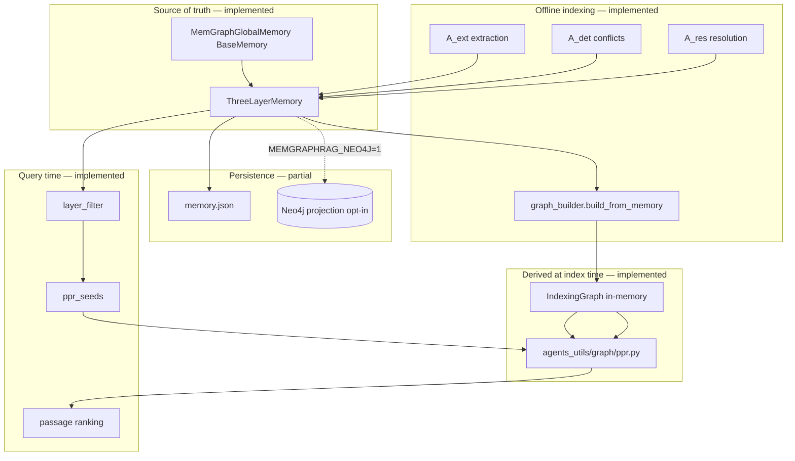

# MemGraphRAG: memory graph construction, updates, Neo4j, and PPR

This document describes **how qlab’s MemGraphRAG experiment builds and updates the hierarchical memory graph**, how that relates to **three-layer global memory** and **Neo4j**, and **how memory-guided retrieval (including PPR) runs**. Sections label **Implemented (testing)** vs **Planned / partial** so you can refactor toward Neo4j scalability without losing paper semantics.

**Code map**

| Concern | Module | Status |
|--------|--------|--------|
| Global memory (M_ont, M_fac, M_pas) | `memgraphrag_core/memory/three_layer.py` | Implemented (in-process) |
| qlab `BaseMemory` adapter | `memgraphrag_core/memory/memgraph_memory.py` | Implemented (`add`, `afind`, `adelete`, `aclear`) |
| Multi-agent indexing | `memgraphrag_core/agents/*`, `indexing/orchestrator.py` | Implemented (fixture + LLM via `MEMGRAPHRAG_AGENTS`) |
| Hierarchical graph build | `memgraphrag_core/indexing/graph_builder.py` | Implemented (schema / fact / passage nodes + edges) |
| Memory-guided retrieval | `memgraphrag_core/retrieval/*` | Implemented (layer filter → seeds → igraph PPR + dense fallback) |
| JSON persistence | `memgraphrag_core/storage/memory_store.py` | Implemented (`memory.json` on index + restore on startup) |
| Neo4j projection | `memgraphrag_core/storage/neo4j_store.py` | Implemented (opt-in: `MEMGRAPHRAG_NEO4J=1` + external Bolt) |
| HTTP | `server/routes/*` | Implemented (see §6); no Streamlit UI |

Paper: [MemGraphRAG (KDD 2026)](https://arxiv.org/abs/2606.00610). Reference: [XMUDeepLIT/MemGraphRAG](https://github.com/XMUDeepLIT/MemGraphRAG) (`Memory.py`, `MemGraphRAG.py`).

Cross-reference: HippoRAG’s working PPR + Neo4j dual-write pattern in [`../hipporag/MEMORY_GRAPH.md`](../hipporag/MEMORY_GRAPH.md).

---

## 1. Conceptual model (paper vs qlab)

MemGraphRAG separates **global memory** from the **indexing graph**:

| Layer | Paper notation | qlab type | Role |
|-------|----------------|-----------|------|
| Ontology | M_ont | `OntologySchemaRecord` | Schema/type patterns + extraction frequency (stability) |
| Facts | M_fac | `FactRecord` | Concrete assertions linked to passages |
| Passages | M_pas | `PassageRecord` | Evidence text (immutable source) |

**Agents (offline indexing):**

- **A_ext** — extraction: passage → candidate schemas + facts (+ grounding).
- **A_det** — conflict detection on **hard conflicts** when new facts activate.
- **A_res** — resolution using passage evidence; may **drop** or merge facts.

The **hierarchical indexing graph** is a **derived view** built from consistent memory—not a second source of truth. Retrieval (paper §4.3) **filters** memory layers by query similarity, builds **structure-aware PPR seeds**, runs PPR, ranks passages (with dense fallback when needed).



---

## 2. Implemented: three-layer memory and adapter

### 2.1 Records (`memgraphrag_core/models.py`)

- **PassageRecord** — `id`, `text`.
- **FactRecord** — `id`, `text`, `passage_ids[]`, `schema_ids[]`.
- **OntologySchemaRecord** — `id`, `label`, `extraction_count`.

### 2.2 Store (`ThreeLayerMemory`)

In-memory dicts per tier:

- `add_passage` / `add_fact` / `add_ontology`
- `delete_fact` / `delete_passage` — used after conflict resolution and `adelete`
- `clear` — all tiers empty

Counts surface on `GET /health` via `MemGraphGlobalMemory` properties.

### 2.3 BaseMemory adapter (`MemGraphGlobalMemory`)

| Method | Behavior (testing) |
|--------|-------------------|
| `build_or_restore(config)` | Load `memory.json` when present; rebuild `IndexingGraph` from tiers |
| `add` | Stage passages in M_pas (dict / str / `PassageRecord`) |
| `afind` | `MemoryGuidedRetriever` → PPR or dense fallback |
| `adelete` | Remove fact or passage by id; rebuild graph if a fact was removed |
| `aclear` | Clear tiers + drop in-memory graph (`POST /reset`) |

Config: `MemGraphMemoryConfig` (`memory/config.py`) — `memory_data_dir`, `retrieval_sim_threshold`, `ppr_damping`, `retrieval_top_k`, `neo4j_enabled` (gates projection when Neo4j client is wired).

### 2.4 Docker / Neo4j today

`memgraphrag/docker-compose.yml` runs **agent only** — **no bundled Neo4j service** (same pattern as early HippoRAG: point at a local or shared Neo4j instance). Volume: `memgraphrag/.data/memory` → `/data/memory` for `memory.json`.

Enable projection when a Bolt endpoint is reachable:

```bash
MEMGRAPHRAG_NEO4J=1
NEO4J_URI=bolt://host.docker.internal:7687   # example
```

---

## 3. Implemented: graph construction (indexing pipeline)

Orchestration: `IndexOrchestrator.run_full_index()` in `indexing/orchestrator.py`.

### 3.1 Sequence (as implemented)

```
1. Corpus staged in M_pas (POST /corpus/passages, /corpus/load-toy, or startup MEMGRAPHRAG_BOOTSTRAP_TOY=1)
2. For each passage (corpus iteration order):
     a. A_ext.extract(passage_id, text) → schemas, facts
     b. apply_extraction → merge into M_ont / M_fac (passage + schema links)
3. For all passages indexed in this run:
     a. A_det.detect(memory, new_fact_ids) → conflict groups
     b. For each group: A_res.resolve(memory, group) → drop facts in M_fac
4. rebuild_index_graph(encoder) → IndexingGraph (+ node embeddings)
5. save_memory → memory.json
6. If neo4j client attached and config.neo4j_enabled: Neo4jMemoryProjection.sync_layers
```

Fixture path (no LLM): `eval/toy_conflict/` — `corpus.json`, `extraction.json`, `conflicts.json`, `resolutions.json` (Newton birth-year conflict demo). One-shot API: `POST /corpus/bootstrap-toy`.

LLM path: `MEMGRAPHRAG_AGENTS=llm` with OpenAI-compatible API (see `agents/.env-template`).

### 3.2 Hierarchical graph (`indexing/graph_builder.py`)

**Nodes:**

| Node kind | Source | Notes |
|-----------|--------|--------|
| Schema | M_ont | `kind=schema` |
| Fact | M_fac | Active facts after resolution |
| Passage | M_pas | `passage_indices` for ranking |

**Edges (implemented):**

| Edge | Meaning |
|------|---------|
| Schema ↔ Fact | `fact.schema_ids` |
| Fact ↔ Passage | `fact.passage_ids` |

**Not yet in graph builder:** Fact–fact conflict / coreference edges; upstream parity pass against official `MemGraphRAG.py` may add more edge types.

`IndexingGraph` holds `node_keys`, `node_texts`, `node_vectors`, undirected `edges`, and `passage_indices` for PPR → passage ranking.

### 3.3 Graph updates (testing semantics)

| Event | M_ont / M_fac / M_pas | Indexing graph |
|-------|------------------------|----------------|
| New passage | Insert M_pas | Unchanged until `POST /index` |
| Extraction + index | Upsert schemas/facts | **Full rebuild** on each `run_full_index` |
| Conflict resolution | Delete facts in M_fac | Rebuild omits dropped facts |
| `POST /reset` / `aclear` | Clear all tiers | Drop in-memory graph; Neo4j clear if connected |

**Planned:** `graph_version` monotonic snapshots, incremental rebuild, persisted PPR adjacency (see §7).

Unlike HippoRAG, **facts can be removed** after resolution; the graph builder **omits dropped facts** on rebuild.

---

## 4. Implemented: memory-guided retrieval and PPR

Entry: `MemoryGuidedRetriever.retrieve` (also `MemGraphGlobalMemory.afind` and `POST /retrieve`).

### 4.1 Pipeline (paper §4.3)

1. **Encode query** — `BaseEncoder` (`HashDenseEncoder` in tests; `SentenceTransformersEncoder` + `EMBEDDING_MODEL` in dev).
2. **Layer filter** (`retrieval/layer_filter.py`) — cosine similarity ≥ `retrieval_sim_threshold` over ontology labels, fact texts, passage texts.
3. **PPR seeds** (`retrieval/ppr_seeds.py`) — map filtered ids to graph node indices; structure-aware weights.
4. **PPR** — `run_personalized_pagerank` in `agents_utils/graph/ppr.py` on undirected edges from `IndexingGraph`.
5. **Rank passages** — aggregate mass on `passage_indices`.
6. **Fallback** — dense cosine over passage texts when graph is empty or filter/PPR yields no hits.

### 4.2 Difference from HippoRAG PPR

| Aspect | HippoRAG | MemGraphRAG (qlab testing) |
|--------|----------|----------------------------|
| PPR node set | Entities only | Schema / fact / passage nodes |
| Seeds | Query entity → entity argmax link | Layer filter + structure-aware weights |
| Memory input | Implicit in graph | Explicit M_ont, M_fac, M_pas before graph |
| Graph mutability | Mostly monotonic growth | Facts **removed** after conflicts |

**Planned:** abstract `PprSnapshot` provider; Neo4j GDS PageRank parity (§8).

---

## 5. Optional Neo4j projection (implemented)

### 5.1 Design (`storage/neo4j_store.py`)

Same philosophy as HippoRAG:

- **Authoritative for qlab retrieval:** in-process `ThreeLayerMemory` + in-memory `IndexingGraph` (rebuilt after load/index).
- **Neo4j:** optional **projection** for Browser analytics when `MEMGRAPHRAG_NEO4J=1` and Bolt env vars are set.

`MemGraphMemoryConfig.neo4j_enabled` must be true for sync after index.

**Ops:** use a separate Neo4j instance from HippoRAG when both run locally (different Bolt ports).

### 5.2 Neo4j schema (current MERGE)

| Label | Key | Properties |
|-------|-----|------------|
| `Schema` | `id` | `label`, `extraction_count` |
| `Fact` | `id` | `text` |
| `Passage` | `id` | `text` |

| Relationship | Endpoints |
|--------------|-----------|
| `INSTANCE_OF` | `Fact` → `Schema` |
| `SUPPORTED_BY` | `Fact` → `Passage` |

**Partial:** PPR structural edges from `IndexingGraph` are **not** written to Neo4j yet (`sync_layers` uses tiers only).

Example Cypher:

```cypher
MATCH (s:Schema)<-[:INSTANCE_OF]-(f:Fact)-[:SUPPORTED_BY]->(p:Passage)
RETURN s, f, p LIMIT 100;
```

### 5.3 Sync points (implemented)

| When | Action |
|------|--------|
| After `run_full_index` | `sync_layers(memory, index_graph)` — tier nodes + INSTANCE_OF / SUPPORTED_BY |
| After `POST /reset` | `aclear()` + `neo4j.clear()` when client attached |
| On `adelete(fact_id)` | Memory + graph rebuild; **no** automatic Neo4j patch yet |

**Not planned for v1:** read-path Cypher on every retrieve (use in-memory snapshot + igraph PPR).

---

## 6. HTTP API

| Route | Status | Graph / memory effect |
|-------|--------|------------------------|
| `GET /health` | Implemented | Tier counts |
| `POST /reset` | Implemented | `aclear()`; optional Neo4j clear |
| `POST /corpus/passages` | Implemented | Stage M_pas |
| `POST /corpus/load-toy` | Implemented | Stage toy passages only |
| `POST /corpus/bootstrap-toy` | Implemented | Toy passages + fixture `run_full_index` |
| `POST /index` | Implemented | Full orchestrator (A_ext → A_det → A_res → graph → JSON) |
| `POST /retrieve` | Implemented | Memory-guided PPR (+ fallback) |

Startup: optional toy bootstrap when `MEMGRAPHRAG_BOOTSTRAP_TOY=1` (see `main.py` lifespan).

**Planned:** `POST /ask` with LLM reader over retrieved passages.

---

## 7. Persistence

| Artifact | Path | Status |
|----------|------|--------|
| `memory.json` | config `memory_data_dir` | **Implemented** — ontology, facts, passages |
| Graph snapshot | — | **Rebuild on load/index** from tiers + encoder (not serialized) |
| Agent / LLM cache | — | Planned |

`build_or_restore`: load JSON → `rebuild_index_graph()` → optional Neo4j on next index only.

---

## 8. Future refactor: Neo4j for scalability

Use this checklist when promoting Neo4j from projection to **system of record**.

### 8.1 Invariants to preserve

1. **Three-layer semantics** — resolution removes facts from M_fac; graph and Neo4j must reflect **active** facts only.
2. **Memory-guided filter** — retrieval must use layer similarity before PPR (not “whole-graph PPR only”).
3. **Seed construction** — structure-aware seeds are not interchangeable with HippoRAG entity-only seeds.
4. **Evidence** — passage ranking must trace to M_pas support links.

### 8.2 Migration phases

| Phase | Description |
|-------|-------------|
| M1 | Dual-write tiers + **graph edges** to Neo4j; retrieve still from RAM snapshot |
| M2 | Export subgraph Cypher → igraph (HippoRAG Option B) |
| M3 | GDS PageRank on projected graph; parity tests vs igraph |
| M4 | Optional: store embeddings on Schema/Fact/Passage nodes; vector index for layer filter |
| M5 | Optional: drop in-memory edge store; versioned GDS graph name per `graph_version` |

### 8.3 Reuse from HippoRAG

| HippoRAG artifact | MemGraphRAG reuse |
|-------------------|-------------------|
| `Neo4jGraphStore` subclass pattern | Evolve `Neo4jMemoryProjection` |
| `export_ppr_snapshot` / shared PPR | In use via `agents_utils/graph/ppr.py` |
| `passage_scoring.py` | Generalize mention/support matrix (partial — passage node ranking today) |
| Compose + GDS plugin | Add Neo4j service block when needed |
| Parity pytest | Expand toy conflict golden retrieve |

### 8.4 Remaining work before Neo4j-first retrieval

1. Dual-write **IndexingGraph** edges (and optional `graph_version`) to Neo4j.
2. Incremental index / snapshot files (avoid full encoder pass on every cold start).
3. `adelete` → Neo4j patch or full resync policy.
4. Upstream field-level parity (`Memory.py`) and richer eval (multi-hop QA).

---

## 9. Toy eval corpus

`eval/toy_conflict/` — two passages, conflicting Newton birth years (`f_newton_1642` vs `f_newton_1643`), fixture extraction and resolution.

**Expected after fixture index + resolution:**

- **M_fac:** one surviving birth-year fact (`f_newton_1642`; `f_newton_1643` dropped per `resolutions.json`).
- **Indexing graph:** fact nodes only for the survivor; edges to supporting passage(s) and schema nodes from extraction fixture.
- **Retrieve:** queries about Newton’s birth year should rank the passage that supports the kept fact (PPR or dense fallback depending on encoder threshold).

See `tests/test_fixture_pipeline.py` and `tests/test_memgraphrag_api.py` (`bootstrap-toy` + retrieve).

---

## 10. Related docs

- [`PLAN.md`](PLAN.md) — phased delivery (checklist may lag; prefer this file for graph/PPR truth).
- [`README.md`](README.md) — quick start and **Testing** status.
- HippoRAG reference implementation of PPR + Neo4j dual-write: [`../hipporag/MEMORY_GRAPH.md`](../hipporag/MEMORY_GRAPH.md).
