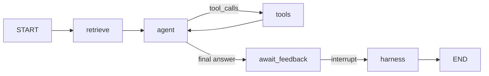

# ReHarness experiment

Local agent harness for **agentic continual learning**: retrieve past reflections, act on a task, then **revise** retrieved memories and **write** a new reflection from user feedback. This folder is our reimplementation for hands-on experiments—not the authors’ official code.

## Paper

**Recurrent Harness for Agentic Continual Learning** — Yuxin Xiao, Zhiyun Lu, Jianyu Wang, Yangtian Zhang, Yang Song, Qifan Wang, Bailin Wang.

- HTML: [arxiv.org/html/2610.12668](https://arxiv.org/html/2610.12668)
- PDF: [arxiv.org/abs/2610.12668](https://arxiv.org/abs/2610.12668)

The paper proposes **ReHarness**: a streaming harness around a decision agent πD with:

1. **Forward read** — retrieve relevant textual reflections from harness state before each instance.
2. **Forward write** — after an instance, a memory agent πM adds a new reflection from the trajectory and outcome.
3. **Backward revision** — a revision agent πR revisits reflections that were **retrieved for the current instance**, using the **latest** trajectory and reward as feedback while keeping new content **grounded in each reflection’s source trajectory**.

That closes a recurrent loop so overgeneral or outdated lessons (e.g. “put larger numbers first” after a descending sort, then misapplied to ascending) can be **narrowed** instead of polluting future retrievals.

## What we built

We reimplemented the harness ideas for our **`agents`** stack so we can run repeatable experiments with tracing and a small tool-using agent.

| Paper concept | Our implementation |
|---------------|-------------------|
| Harness state (reflection bank) | **Qdrant** collection (`config/qdrant_memory.json`) via `QdrantMemory` + **sentence-transformers** embeddings |
| πD | LangGraph **ReAct** loop: `ChatOpenAI` + `run_python` tool; reflections injected in the **system prompt** only |
| πM / πR | `harness/reharness.py` — same LLM with **`with_structured_output`** (`MemoryAgentOutput`, `RevisionAgentOutput`); prompts in `harness/prompts.py` |
| Instance trajectory τ | `harness/trajectory.py` serializes instance messages (no system prompt) to text for πM and πR |
| Outcome / reward | **Qualitative user feedback** after the agent finishes (not automated env reward). The decision agent asks for feedback; the user replies via API or Streamlit UI |
| Streaming protocol | One **task = one graph run** with a new `thread_id`. **No** cross-task chat history in the LLM window—only retrieved reflections carry past tasks |

## Experiments and Review

The experiments in the paper included asking the agent to implement a routine to sort numbers in ascending and later in descending order to test if the agent carried over lessons from its previous interactions blindly. 

For us we are using GPT-6-Luna and given the intelligence of the model, trivial coding exercises would not test the strength of the harness well enough. So instead we tested its ability to learn from user preferences.

Our experiment involved asking the model to structure its response to suit the question.

**`User`**:
> `tell me what is the best tokenizer to use in a situation where the text is multilingual, carries non-prose formats like code and logs and html alongside your normal documents? something that runs really fast.`

**`agent`**
>`{"recommendation":"Use the tokenizer native to your model. If choosing for an OpenAI model, use o200k_base (GPT-4o).","why":"It is fast and designed for broad multilingual coverage; one tokenizer can handle prose, code, logs, and HTML.","caveat":"Tokenizer quality and speed depend on the model and workload, so benchmark representative text before committing. For another model, use its own tokenizer.","feedback_question":"Was this recommendation and level of detail useful, or should I improve anything?"}`

**`user`**
>`when i ask for a recommendation, yes one of the keys should be recommendation but your reasoning should be compressed into a single key, including your caveat. specific to recommendations, you should also have provided one additional key called 'alternative' so i know whats the next best alternative. in your reasoning, you should explain why the alternative was not recommended.`

**`agent`**
>`{"reflection":"- Operational evidence:\n - The response used compact JSON and included a recommendation key, but split reasoning and caveat across why and caveat instead of consolidating them.\n - It omitted the requested alternative key and included an unnecessary feedback_question.\n - It recommended o200k_base while also noting that tokenizer choice depends on the target model and workload.\n- Interpretations and reusable strategies:\n - For recommendation requests, use recommendation, one concise reasoning key that includes the caveat, and alternative; briefly explain in the reasoning why the alternative is not preferred.\n - Keep JSON compact and omit follow-up questions unless requested. Tie tokenizer advice to the target model, and qualify speed or coverage claims when they depend on the workload."}`

**`user`**
>`tell me what is the capital of France, Russia and Kazakhstan.`

**`agent`**
> `France: Paris`
> `Russia: Moscow`
> `Kazakhstan: Astana`
> 
> `Was this answer and approach helpful, or is there anything you’d like me to improve?`

Right here it was apparent that indeed the lesson from the earlier interaction is not universally applied. Firstly the json structure is gone. Secondly, the agent did not discuss an alternative option because that would not make sense since the user is no longer seeking a recommendation.

**`user`**
> `tell me what is the best way to cook turbot`

**`agent`**
> `{ "recommendation": "Roast the turbot whole, on the bone—it’s a forgiving way to keep this delicate fish moist and bring out its flavor.", "method": [ "Heat the oven to 200°C (400°F). Pat the fish dry, season with salt and pepper, and place it in a lightly oiled roasting dish.", "Add a few knobs of butter, a splash of white wine or water, and lemon slices or herbs if you like.", "Roast until the flesh at the thickest part is just opaque and separates easily from the bone. Timing varies with the fish’s size, so start checking after about 20 minutes; a thermometer in the thickest part should read 63°C (145°F) for the standard food-safety recommendation.", "Rest for 5 minutes, then serve with the buttery pan juices." ], "alternative": "For fillets, pan-sear skin-side down in oil until nearly cooked through, then briefly turn and finish with butter. It’s quicker, but easier to overcook than roasting the whole fish.", "feedback_question": "What worked well or missed the mark in this answer, and what would you like me to improve next time?" }`

Here you can see that when the user now asks for a recommendation, the same format reappears, complete with the recommendation key and the alternative. Bear in mind here that unlike the usual agent set up, our agent here has no access to past messages in the conversation - meaning the only way it decided to include `alternative` as a key and use JSON formatting must come from the retrieved lessons. One problem though is that the reasoning was not provided as a separate key like I wanted. although it does appear in parts of the answer like `It’s quicker, but easier to overcook than roasting the whole fish`.

While it does appear that the harness allows the agent to learn and retain lessons, its less clear whether the discretionary application of learnings comes from the model's own ability to reason or from the lessons themselves. Its probably a good idea for the model to try and store lessons learnt for retrieval but the ability of the model to distil the right lesson from past trajectories also depends on the intelligence level of the model. This approach still requires token spend in order to execute so if there were other competing requirements, like fact checking answers say, which have higher value, this might not be really the best approach. If the lessons were sufficiently small and the task scope narrow, would it not be better to maintain a simple markdown listing lessons learnt? 

## Appendix - Implementation Details
### LangGraph flow

- **`retrieve`** — top‑k similarity search on the current task text (`REHARNESS_TOP_K`, default 5).
- **`agent` / `tools`** — standard tool loop until the model stops with a final answer and a question for the user.
- **`await_feedback`** — LangGraph **interrupt**; resume with `POST /tasks/{id}/feedback/stream`.
- **`harness`** — for each retrieved item: πR → delete old point → re‑index revised payload (preserves source task, source trajectory, original feedback); then πM forward‑writes one new reflection (optionally using revised texts as demonstrations).

Checkpoints (**SQLite**, `CHECKPOINT_PATH`) exist only to **persist interrupt/resume within a single task**, not to accumulate multi-task dialogue.

### Deliberate scope choices

- **Single tool** — `run_python` in a subprocess (timeout configurable). Enough for coding-style and format experiments without binding to CL-Bench or custom envs.
- **Shared runtime image** — `agents-runtime:latest` from `agents/build-image.sh`; ReHarness compose mounts data under `reharness/.data/`.
- **Observability** — optional **Langfuse** (`AGENT_NAME=reharness`) on graph invocations; file logs under `AGENT_LOG_DIR` when running in Docker.
- **Not included** — benchmark suites, automated reward models, replay buffers, or gradient-based harness tuning from the paper’s full evaluation setup. We optimize for **manual task streams** and inspecting Qdrant + traces.

Cross-task learning should show up as **retrieval + revision**, not as the model “remembering” prior chats. Each new task in the Streamlit tester should use **New task** (fresh thread); lessons should appear only under “Retrieved lessons” in the system prompt.

## Quick start

1. Copy env: `agents/.env` from `agents/.env-template` (API keys, Langfuse keys).
2. Build image: `cd agents && ./build-image.sh`
3. (Optional) Langfuse stack: `docker compose -f docker-compose.langfuse.yml up -d`
4. ReHarness: `./reharness/run-agent.sh` (or `--rebuild-image` after code changes)
5. UI: `./reharness/run-ui.sh` → chat tasks; submit feedback when interrupted; use **New task** for the next instance in the stream.

API:

- `POST /tasks/stream` — body `{"task": "..."}` → NDJSON events (`retrieve`, `llm_delta`, `interrupt`, …)
- `POST /tasks/{task_id}/feedback/stream` — body `{"feedback": "..."}` → runs harness, then `harness_complete`

Stop stack: `./reharness/run-agent.sh stop`

## Configuration

See `agents/.env-template` for `OPENAI_MODEL`, `REHARNESS_TOP_K`, `QDRANT_URL`, `CHECKPOINT_PATH`, `REHARNESS_AGENT_URL`, etc. ReHarness does **not** use `CONTEXT_LIMIT` / `AgentContextManager`; raising context does not substitute for the reflection bank.

Optional **web tools** (`REHARNESS_WEB_TOOLS=1`) register shared `agents_utils` **`websearch`** (LangSearch via `LANGSEARCH_API_KEY`) and **`webfetch`** (Playwright) alongside **`run_python`**. When disabled (default), only the Python runner is bound to the graph.