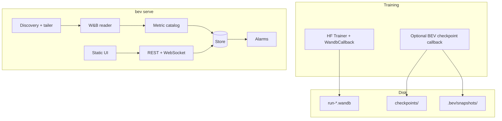

# BEV — local training diagnostics

**Status:** pre-alpha (developed in the **qlab** repo as a vendored tree; **not** the
long-term home for the product).

**Repository home:** BEV will be **carved out into its own repository** before beta / PyPI.
The **qlab** repo is a **personal sandbox** (pathology tutorials,
experiments, dogfooding). Nothing in BEV should assume it permanently lives under
`tutorials/pathologies/bev/` — that path is convenience for sandbox development only.

**Goal:** A lightweight, local-first alternative to W&B for *understanding* training runs:
shared axes, structure-aware metrics (not regex-only), checkpoint heatmaps, and pre-built
alarms. **Compatible with existing HuggingFace + `WANDB_DIR` logging** — read local
`.wandb` runs without requiring cloud sync.

**Progress convention:** mark subtasks done by changing `[ ]` → `[x]`. Phases are done when
all their subtasks are `[x]`.

---

## 1. Product shape

| Piece | Role |
|--------|------|
| `backend/bev/` (import `bev`) | CLI, W&B ingest, store, alarms, optional HF callbacks, HTTP API |
| `webui/` | Svelte 5 + Vite source; production build → `static/` (gitignored locally) |
| `sdk/bev_sdk/` | Training-time hooks (ingest nudge, callbacks); import `bev_sdk` |
| `e2e/` | Playwright + serve harness (not shipped to end users) |

**Default end-user experience (post–Phase 4):** `pip install` → one command serves API **and**
bundled UI (no Node). **Optional** split CLIs / Docker services for operators who want separate
API and UI containers (see **Phase 5**).

**Distribution (own repo, PyPI wheels, console scripts, Docker)** is the **last development
phase** (Phase 4–5). Until carve-out, develop the tree under qlab with
`PYTHONPATH=backend/` and `scripts/`; pathology `run.sh` / `.data` runs are **consumers**, not
owners of the BEV codebase.

### 1.1 UI stack

- [x] Svelte 5 + Vite app under `webui/`
- [x] Time series: uPlot
- [ ] Release build bundled into `bev` wheel via Hatch (Phase 4); `static/` not committed

### 1.2 Engine split

- [ ] **Python:** `.wandb` ingest, SQLite/column store, downsampling, alarms, checkpoint tensors
- [ ] **TypeScript:** layout, shared-scale groups, metric tree picker, heatmap navigation

### 1.3 Metrics vs architecture (mental model)

| Level | Example keys | UI today | SDK / store (future) |
|-------|----------------|----------|----------------------|
| **Run** | `train/loss`, `train/learning_rate` | Sidebar family → line panel | Log as-is |
| **Architecture-scoped** | `train/grad_norm/layer.0`, `train/update_rank/model.layers.…` | Sidebar family only; multipanel + path regex for layers | SDK records **model architecture** and enforces **consistent layer/module naming** in metric paths |

- [x] Sidebar: **`GET /metric-families`** only (top-level `train/<metric>`), always visible
- [ ] **`bev_sdk`:** optional architecture manifest (modules, layers, param names) written alongside W&B logs or sent to backend on ingest
- [ ] **Store:** persist architecture snapshot per run (linked from `run_meta` or sidecar JSON)
- [ ] **UI:** architecture browser (read-only) driven by SDK manifest + metric path conventions
- [ ] **Validation:** SDK warns when logged keys do not match declared architecture segments

The thin SDK stays HTTP + callbacks; architecture consistency is **metadata + naming rules**, not
duplicate ingest logic.

---

## 2. W&B local compatibility

Source of truth: [`wandb_internal.proto`](https://github.com/wandb/wandb/blob/main/wandb/proto/wandb_internal.proto),
read via [`wandb.sdk.internal.datastore`](https://github.com/wandb/wandb/blob/main/wandb/sdk/internal/datastore.py).

### 2.1 Directory layout (discovery parity)

Expected layout (matches pathology lab `run.sh`):

```text
{WANDB_DIR}/
  wandb/
    latest-run -> run-YYYYMMDD_HHMMSS-<id>/
    run-YYYYMMDD_HHMMSS-<id>/
      run-<id>.wandb
      files/                    # optional offline until sync
    offline-run-YYYYMMDD_HHMMSS-<id>/
```

- [ ] Resolve scan roots: `WANDB_DIR`, `./wandb`, config file watch list
- [ ] Glob `**/wandb/run-*` and `**/wandb/offline-run-*`
- [ ] Follow `latest-run` symlink
- [ ] Require `run-*.wandb` per run directory
- [ ] Parse run metadata from protobuf (`run_id`, display name, project, entity)
- [ ] Index `.wandb` mtime/size for incremental tailing

### 2.2 Metric stream

- [ ] Decode `HistoryRecord` → keys + `value_json`, step from `_step`
- [ ] Prefer `train/global_step` when present for x-axis
- [ ] Honor `MetricRecord` step_metric when present in file
- [ ] Preserve metric key strings (`train/...`) for W&B parity

### 2.3 Optional `files/` (nice-to-have)

- [ ] Read `config.yaml` when present
- [ ] Read `wandb-summary.json` for cold-start last values
- [ ] Read `wandb-metadata.json` for paths / CLI args
- [ ] Optional “Console” panel from `output.log` (not source of truth for charts)

### 2.4 Explicit non-goals (v1)

- [ ] Document: no cloud-only runs, no artifact registry, no full W&B GraphQL API

### 2.5 Offline quirk

- [ ] Do **not** require `files/` for charts (history lives in `.wandb` even when summary JSON missing pre-sync)

---

## 3. System architecture



### 3.1 Python modules (target layout)

```text
bev/
  PLAN.md
  __init__.py
  cli.py
  discovery/
  ingest/
    wandb_reader.py
  store/
  catalog/
  recipes/
  alarms/
  snapshots/
  server/
  callbacks/
  web/
```

- [ ] Scaffold package directories + empty `__init__.py` files
- [ ] `discovery` — scan roots, run list, checkpoint link heuristics
- [ ] `ingest.wandb` — tail `.wandb`, normalized step events
- [ ] `store` — per-run persistence + query API helpers
- [ ] `catalog` — metric path tree
- [ ] `recipes` — bundled dashboard YAML
- [ ] `alarms` — rule engine
- [ ] `snapshots` — checkpoint tensor export read path
- [ ] `server` — FastAPI/Starlette + static + WebSocket
- [ ] `callbacks` — optional HF `TrainerCallback`

### 3.2 Linking runs to checkpoints

Pathology convention: `.data/<RUN_ID>/wandb` + `.data/<RUN_ID>/checkpoints`.

- [ ] Auto-link sibling `checkpoints/` when folder names match `WANDB_RUN_NAME`
- [ ] Read `wandb-metadata.json` training paths when synced
- [ ] Optional sidecar `.bev/link.json` written by callback or user

---

## 4. Storage (low CPU / RAM)

**Database:** SQLite (`stdlib sqlite3`) — **one `run.db` per W&B run**. The tailer **appends**
on ingest; the UI **reads** the DB only (no re-parse of `.wandb` on each chart load).

**Pragmas on open:** `foreign_keys=ON`, `journal_mode=WAL`, `synchronous=NORMAL`.

### 4.1 On-disk layout

```text
<store-dir>/runs/<wandb_run_id>/     # default store-dir: ~/.bev/store (per BEV instance)
  run.db
  series/              # optional: when metrics_catalog.storage = 'file'
  snapshots/           # checkpoint heatmaps (not SQL blobs)
```

Optional watch-root index: `bev_index.db` listing many runs (see §4.4).

- [ ] Implement `run.db` schema v1 + `schema_migrations` table
- [x] Central store dir per BEV instance (`--store-dir`, `BEV_STORE_DIR`, default `~/.bev/store`)
- [ ] Server-side downsample (`max_points`, LTTB or min-max buckets) on read path
- [ ] Full resolution only for zoomed step windows
- [ ] Escape hatch: `metrics_catalog.storage = 'file'` + `series/*.f32.zst` (same keys, no schema break)

### 4.2 SQLite schema (v1)

| Table | Purpose |
|-------|---------|
| `schema_migrations` | Applied migration versions |
| `run_meta` | Single row: W&B identity, paths, `store_version` (UI poll) |
| `ingest_state` | Single row: tail `byte_offset`, file size/mtime |
| `steps` | One row per W&B `_step` + optional `global_step`, `epoch`, `logged_at` |
| `metrics_catalog` | One row per metric **key**; `path_segments` JSON; storage mode |
| `metric_values` | Scalar series: `(metric_id, step)` → value |
| `alarm_events` | Fired rules per step |
| `snapshot_index` | Pointers to checkpoint heatmap manifests (Phase 3) |

```sql
CREATE TABLE schema_migrations (
  version     INTEGER PRIMARY KEY,
  applied_at  TEXT NOT NULL DEFAULT (datetime('now'))
);

CREATE TABLE run_meta (
  id               INTEGER PRIMARY KEY CHECK (id = 1),
  wandb_run_id     TEXT NOT NULL UNIQUE,
  display_name     TEXT,
  project          TEXT,
  entity           TEXT,
  wandb_dir        TEXT NOT NULL,
  wandb_file       TEXT NOT NULL,
  checkpoint_dir   TEXT,
  store_version    INTEGER NOT NULL DEFAULT 0,
  created_at       TEXT NOT NULL DEFAULT (datetime('now')),
  updated_at       TEXT NOT NULL DEFAULT (datetime('now'))
);

CREATE TABLE ingest_state (
  id                 INTEGER PRIMARY KEY CHECK (id = 1),
  byte_offset        INTEGER NOT NULL DEFAULT 0,
  file_size          INTEGER NOT NULL DEFAULT 0,
  file_mtime_ns      INTEGER,
  last_wandb_step    INTEGER,
  last_ingest_at     TEXT NOT NULL DEFAULT (datetime('now'))
);

CREATE TABLE steps (
  step          INTEGER PRIMARY KEY,
  global_step   INTEGER,
  epoch         REAL,
  logged_at     REAL
);
CREATE INDEX idx_steps_global_step ON steps (global_step);

CREATE TABLE metrics_catalog (
  metric_id       INTEGER PRIMARY KEY AUTOINCREMENT,
  key             TEXT NOT NULL UNIQUE,
  dtype           TEXT NOT NULL DEFAULT 'float'
                  CHECK (dtype IN ('float', 'int', 'string', 'null')),
  first_step      INTEGER,
  last_step       INTEGER,
  n_points        INTEGER NOT NULL DEFAULT 0,
  path_segments   TEXT,
  storage         TEXT NOT NULL DEFAULT 'inline'
                  CHECK (storage IN ('inline', 'file')),
  storage_ref     TEXT
);
CREATE INDEX idx_metrics_catalog_key ON metrics_catalog (key);

CREATE TABLE metric_values (
  metric_id    INTEGER NOT NULL,
  step         INTEGER NOT NULL,
  value_real   REAL,
  value_int    INTEGER,
  value_text   TEXT,
  PRIMARY KEY (metric_id, step),
  FOREIGN KEY (metric_id) REFERENCES metrics_catalog(metric_id) ON DELETE CASCADE,
  FOREIGN KEY (step) REFERENCES steps(step) ON DELETE CASCADE
);
CREATE INDEX idx_metric_values_step ON metric_values (step);

CREATE TABLE alarm_events (
  id          INTEGER PRIMARY KEY AUTOINCREMENT,
  step        INTEGER NOT NULL,
  rule_id     TEXT NOT NULL,
  severity    TEXT NOT NULL CHECK (severity IN ('info', 'warning', 'critical')),
  message     TEXT NOT NULL,
  metric_key  TEXT,
  fired_at    TEXT NOT NULL DEFAULT (datetime('now')),
  FOREIGN KEY (step) REFERENCES steps(step)
);
CREATE INDEX idx_alarm_events_step ON alarm_events (step DESC);

CREATE TABLE snapshot_index (
  snapshot_step     INTEGER PRIMARY KEY,
  checkpoint_label  TEXT,
  manifest_path     TEXT NOT NULL,
  indexed_at        TEXT NOT NULL DEFAULT (datetime('now'))
);
```

**Default x-axis:** `steps.global_step` when present, else `steps.step`.

**Not in `run.db`:** dashboard YAML (package `recipes/`), raw `.wandb` (source of truth),
full weight tensors (files under `snapshots/`).

### 4.3 Ingest and tailer (writes DB)

1. **Cold start / new run:** scan `.wandb` from `byte_offset` (0), or resume saved offset.
2. **Live:** on file growth, parse **only new bytes**, advance `ingest_state.byte_offset`.
3. **Per `HistoryRecord`:** upsert `steps` from `_step` and well-known fields on the same
   record (`train/global_step`, `epoch`, `_timestamp`).
4. **Per history item** (non-system key): `ensure_metric_in_catalog` → upsert `metric_values`.
5. **End of batch:** bump `run_meta.store_version`; update optional `bev_index.runs`.

If `file_size < byte_offset`, treat as truncate/replace → reset offset or flag reindex.

**System keys** (not inserted into `metrics_catalog`): `_step`, `_runtime`, `_timestamp`.
`train/global_step` / `train/epoch` update `steps`; charting them as series is optional.

**Transaction pattern:** `BEGIN IMMEDIATE` → writes → update `ingest_state` →
`store_version += 1` → `COMMIT`.

- [ ] Protobuf history parser → normalized history rows
- [ ] Incremental tail with persistent `ingest_state`
- [ ] Ingest transaction + `store_version` bump
- [ ] Reindex command: truncate derived tables, reset offset, full rescan

### 4.4 Populating `metrics_catalog`

Rows are **discovered during ingest only** — one row per distinct metric **key** string from
W&B history (full key preserved, e.g. `train/grad_norm/layer.0`).

**`ensure_metric_in_catalog(key, step, parsed_value)`**

| Event | Action |
|-------|--------|
| First time `key` appears | `INSERT`: `key`, `dtype` from value, `path_segments = analyze_path(key)`, `first_step` = `last_step` = `step`, `n_points` = 1 (if new value row) |
| Same key, later step | `UPDATE` `last_step`, `n_points` += 1 only when inserting a **new** `(metric_id, step)` in `metric_values` |
| Same key, same step again | `ON CONFLICT DO UPDATE` on `metric_values`; do **not** increment `n_points` |

**`dtype`:** infer from JSON — `float` / `int` / `string` / `null`. Charts use float/int.

**`path_segments`:** JSON from deterministic `analyze_path(key)` (see §5.1). Example:

```json
{
  "parts": ["train", "grad_norm", "layer.12"],
  "tokens": [
    {"kind": "literal", "value": "train"},
    {"kind": "literal", "value": "grad_norm"},
    {"kind": "layer", "value": "layer.12", "index": 12}
  ]
}
```

UI tree rollups (e.g. all `train/grad_norm/layer.*`) are derived from catalog keys +
`path_segments`; optional materialized `metric_groups` table later if needed.

**Does not create catalog rows:** `config.yaml`, `wandb-summary.json`, checkpoint manifests,
recipe YAML. Summary-only bootstrap is out of scope for v1.

**Reindex:** replay `.wandb` → rebuild `metrics_catalog` + `metric_values`. Changing
`analyze_path` alone: `UPDATE metrics_catalog SET path_segments = …` without re-reading `.wandb`.

- [ ] `ensure_metric_in_catalog` + dtype inference
- [ ] `analyze_path` wired at first insert
- [ ] Tests: first key, repeat step, incremental tail adds new keys

### 4.5 Optional `bev_index.db` (multi-run discovery)

```sql
CREATE TABLE runs (
  wandb_run_id   TEXT PRIMARY KEY,
  display_name   TEXT,
  project        TEXT,
  wandb_file     TEXT NOT NULL,
  db_path        TEXT NOT NULL,
  last_step      INTEGER,
  store_version  INTEGER,
  updated_at     TEXT
);
```

Updated after each ingest batch so the UI can list runs without scanning every `.wandb`.

- [ ] Watch-root index DB + sync from `run_meta`

### 4.6 Heatmaps (checkpoint-only)

- [ ] Never store full weight matrices in W&B history or `metric_values`
- [ ] Callback writes `snapshots/step-<n>/manifest.json` + downsampled tensors (npz/zarr)
- [ ] Register row in `snapshot_index`; reuse patterns from `pathologies.analysis.second_moment_export`
- [ ] Load one tensor at a time; mmap where possible

---

## 5. Metric catalog (log analyzer)

Path analysis runs at **`metrics_catalog` insert time** (§4.4). This section covers the
analyzer rules and UI-facing tree (not a separate data source).

### 5.1 Phase A — deterministic syntax (ship first)

- [ ] Split keys on `/`
- [ ] Detect `layer.N`, `head.N`, repeated suffix patterns (`-1`, `_1`)
- [ ] Emit `path_segments` JSON + derived `MetricTree` for UI (no regex required to select “all layers”)
- [ ] Map W&B-style `metric_regex` concepts to tree queries in docs

### 5.2 Phase B — optional assist

- [ ] Cluster messy leaf names (embeddings or token similarity) as *suggestions* only
- [ ] UI always shows deterministic parse first

---

## 6. Dashboard config (inheritance)

Schema: `dashboard.v1` (YAML).

| Level | Knobs |
|-------|--------|
| Global | theme, default x (`train/global_step`), color scheme, default `max_points` |
| Panel | shared y-scale group, panel-level ymin/ymax, panel alarms |
| Chart | metrics or tree selector, ymin/ymax override, `match: <sibling>` |

- [ ] Define JSON Schema for `dashboard.v1`
- [ ] Implement merge: global → panel → chart
- [ ] Panel mode: `shared_y` for all charts in panel
- [ ] Chart mode: small multiples for `layer.*` (not one spaghetti chart)
- [ ] Display modes: line, band (p05–p95 across layers), step×layer heatmap for scalars

### 6.1 Built-in recipes

- [ ] `vanishing-gradients` — global norm + per-layer small multiples + early/late ratio + alarm
- [ ] `exploding-gradients` — norm + max-param grad + threshold alarm
- [ ] `adam-collapse` — second-moment layers + Adam health scalars + link to checkpoint heatmaps
- [ ] Port sections from `pathologies.instrumentation.wandb_workspace` as `pathology-lab.yaml`

---

## 7. Alarms

- [ ] Declarative YAML rules (metric glob or tree selector, `last_n_steps`, thresholds)
- [ ] Evaluate on each ingested step
- [ ] Persist `alarm_events` in store; UI badge + list
- [ ] Ship ~10 rules aligned with `doc/failure-modes/`

---

## 8. Server

- [ ] `bev serve` — bind `127.0.0.1`, default port (e.g. 8765), `--open` browser
- [ ] `bev doctor <path>` — runs found, ingestible, checkpoint link, offline warnings
- [ ] Background tail of `.wandb` during training → WebSocket `step` events
- [ ] Localhost-only default; document opt-in `0.0.0.0`

---

## 9. Training callback (optional, user-attached)

- [ ] `CheckpointDiagnosticsCallback` on HF `on_save`
- [ ] Export grad / weight / Adam state slices to checkpoint `.bev/`
- [ ] Compatible with pathology `CheckpointAtStepsCallback` layout

---

## 10. Visualization patterns (vs W&B)

- [ ] Shared y-axis within panel (and optional cross-chart `match`)
- [ ] Small multiples grid for per-layer series
- [ ] Scalar across layers as step×layer heatmap
- [ ] Checkpoint param tree → heatmap with step slider

---

## 11. Migration / mental model

| W&B | BEV |
|-----|-----|
| Project / run | Same metadata from protobuf + folder scan |
| Workspace | `dashboard.yaml` + recipes |
| Regex panels | Metric tree queries |
| Charts | Lines + heatmaps + small multiples |
| `wandb sync` | Not required for metric UI |
| `output.log` | Optional console panel |

- [ ] User-facing “W&B transition” doc section in module README

---

## 12. Phased delivery

### Phase 0 — Spike

- [x] Unit tests under `bev/tests/` (pytest; `pythonpath` includes `tutorials/pathologies`)
- [ ] Golden fixture: tiny synthetic or copied `.wandb` under `bev/tests/fixtures/` (optional committed copy)
- [x] Parse W&B runs into SQLite (`ingest_wandb_file`, central `store-dir`)
- [x] HTTP API (`/api/runs`, manifest, catalog, series, series/prefix)
- [x] Minimal Svelte UI + uPlot (`bev/web` → `bev/static`)
- [x] Small multiples + shared Y for `train/grad_norm/layer.*` (prototype panel)
- [x] `bev serve` + `scripts/serve.sh`, optional `--watch`

### Phase 1 — MVP (sandbox in qlab)

- [ ] `bev serve` CLI wired in sandbox (`uv run python -m bev.cli serve`)
- [ ] Run browser + live tail
- [ ] Metric catalog API
- [ ] Recipes: vanish + explode
- [ ] Basic alarms (2–3 rules)
- [ ] README under `bev/` with pathology `.data` example paths

### Phase 2 — Dashboard DSL

- [ ] Full `dashboard.v1` loader + inheritance
- [ ] Themes + color schemes
- [ ] Import `pathology-lab` recipe from `wandb_workspace.py` panel list
- [ ] Compare two runs (overlay, shared scale)

### Phase 3 — Checkpoint heatmaps

- [ ] `CheckpointDiagnosticsCallback`
- [ ] UI param tree + checkpoint step slider
- [ ] Libify `second_moment_export` helpers into `bev.snapshots`

### Phase 4 — Own repo + packaging (pip install, seamless local start)

**Goal:** Move `backend/`, `webui/`, `sdk/`, `e2e/`, `docs/`, etc. to a **standalone BEV
repository** (repo root = today’s `tutorials/pathologies/bev/` layout). Then
`pip install bev…` (exact names TBD) → working viewer with no checkout and no manual
`PYTHONPATH`. Training code does `import bev_sdk` from the same install or a sibling wheel.
qlab may keep a submodule, path dependency, or copy for sandbox use only.

#### 4.0 Carve-out checklist

- [ ] New git remote; history optional (subtree split or fresh repo + import)
- [ ] Root `pyproject.toml`, README, LICENSE, CI — no dependency on qlab `tutorials/` layout
- [ ] Pathology lab documents “install BEV from PyPI / clone BEV repo” instead of vendored path
- [ ] Remove or shrink qlab `pyproject.toml` BEV `pythonpath` / testpaths after carve-out

#### 4.1 Package layout on PyPI

| Wheel | Import / CLI | Contents |
|-------|----------------|----------|
| **`bev-backend`** (or single `bev` meta) | `import bev`; **`bev-backend start`** (alias: `bev serve`) | API, ingest, store, **prebuilt static assets** inside the wheel |
| **`bev-sdk`** | `import bev_sdk` | Callbacks, optional client to nudge ingest on the server |
| **UI (source)** | — | Not a separate pip runtime for most users; assets ship inside backend wheel |

**Recommended default for “get going”:** one backend wheel that serves bundled static files at `/`
(same as today’s `bev serve`). **`bev-ui start`** is a **developer** command (Vite dev server +
API proxy), published only if we ship an optional `bev-ui` npm package or a `bev[dev]` extra with
documented `npm` steps—not required for pip-only users.

- [ ] `pyproject.toml` at **BEV repo root** (not the qlab monolith)
- [ ] Choose PyPI names (`bev` vs `bev-backend` / `bev-sdk`; avoid namespace collisions)
- [ ] Console scripts: `bev-backend` → `bev.cli:main` (subcommand `start` = serve); keep `bev serve` as alias
- [ ] Optional: `bev-sdk` console script only if CLI needed; otherwise import-only
- [ ] Hatch (or setuptools): build hook runs `webui` production build; include files under `bev/_static/` or `bev/static/` via `package-data` (resolve paths with `importlib.resources`, not repo-relative `product_root()` at runtime for installed wheels)
- [ ] CI: on tag, build webui → wheel → pytest + e2e against **installed** wheel in a clean venv
- [ ] Document: `pip install bev-backend bev-sdk`, `bev-backend start --root …`, env vars (`BEV_STORE_DIR`, `BEV_SCAN_ROOT`)
- [ ] `bev doctor` (paths, wandb reader, store writable, UI assets present)

#### 4.2 Downsides to plan for (not blockers)

| Topic | Downside | Mitigation |
|-------|----------|------------|
| Wheel size | Bundled JS increases download | Cache-friendly assets; optional slim wheel without UI (API-only) extra |
| Build complexity | PyPI artifact depends on Node build | CI-only web build; never commit `static/` |
| Two-process UI/API | `bev-ui start` + `bev-backend start` needs CORS + `BEV_API_URL` | Default single process; enable CORS only when `BEV_UI_ORIGIN` set |
| Version skew | UI and API from different installs | Single wheel for prod; pin versions in Docker Compose |
| Sandbox vendoring | BEV still under `qlab/tutorials/...` | Carve-out in Phase 4; no runtime imports from `pathologies.*` inside BEV |
| `wandb` + torch deps | Heavy transitive deps for SDK-only users | Optional extras: `bev-sdk[trainer]` vs backend depends on `wandb` only |

#### 4.3 Other beta prep

- [ ] `bev export` (Parquet/CSV)
- [ ] Deprecate or keep `scripts/serve.sh` as thin wrapper calling installed `bev-backend`

### Phase 5 — Container distribution (optional operator path)

**Goal:** Same behavior as pip, for teams that prefer Compose/K8s over local Python envs.

- [ ] **Image A (backend):** Python slim + `pip install bev-backend`; `CMD bev-backend start --host 0.0.0.0`; volume mounts for `--root` (W&B scan) and `--store-dir`
- [ ] **Image B (ui)** — only if we ship **split** prod UI (nginx serving static + `BEV_API_URL` to A); skip if Phase 4 bundles static in A (preferred for simplicity)
- [ ] **Image C (training)** — optional; `bev-sdk` + user training code; calls ingest nudge API on A
- [ ] `docker-compose.yml`: one-service default (backend+static); documented two-service dev profile
- [ ] Health: `GET /api/runs` readiness; non-root user; no secrets in image

**Decision guardrails (avoid before Phase 4–5):**

- Do not rely on qlab repo paths or `PYTHONPATH=tutorials/...` in BEV runtime code (sandbox-only today).
- Do not import `pathologies.*` from BEV packages — pathology lab integrates via W&B dirs + optional `bev_sdk`, not shared Python modules.
- Resolve bundled UI via `importlib.resources.files("bev")` (or similar), with `product_root()` only for local dev trees.
- Keep API JSON under `/api/*` and UI at `/` so one hostname works behind a reverse proxy.
- If splitting UI later, add configurable CORS and public API base URL in the webui build early.
- Keep `bev_sdk` HTTP surface minimal (nudge, health) so SDK does not duplicate ingest logic.

---


## 13. Dependencies (planned)

- [ ] Pin `wandb` for protobuf `DataStore` reader (v1)
- [ ] FastAPI + uvicorn (or granian)
- [ ] watchdog for file tail
- [ ] PyYAML for dashboards
- [ ] Optional: duckdb for SQL downsampling (evaluate in Phase 1)

---

## 14. Open decisions

| Topic | Options | Decision |
|-------|---------|----------|
| Public name | `bev`, `trainscope`, other | TBD |
| Pip shape | One wheel vs `bev-backend` + `bev-sdk` | TBD (default: two wheels, backend bundles UI) |
| User start | `bev-backend start` only vs + `bev-ui start` | TBD (default: single command; split for dev/Docker) |
| Chart lib | uPlot vs ECharts-only | uPlot (current) |
| Store | SQLite+columns vs DuckDB single file | TBD |
| v1 wandb dep | Required vs vendored proto only | TBD (default: depend on `wandb`) |
| Static assets at runtime | `product_root()/static` vs package resources | TBD (must be package resources for pip) |
| Long-term repo | Stay vendored in qlab vs own repo | **Own repo** (qlab = sandbox only) |

---

## 15. References

- Pathology W&B layout: `tutorials/pathologies/README.md`, `run.sh` (`WANDB_DIR`)
- Workspace panels source: `instrumentation/wandb_workspace.py`
- Checkpoint + second moment export: `experiments/checkpoint_callbacks.py`, `analysis/second_moment_export.py`
- W&B offline files: [wandb#9646](https://github.com/wandb/wandb/issues/9646)
- W&B sync / paths: [wandb sync docs](https://docs.wandb.ai/models/ref/cli/wandb-sync)
